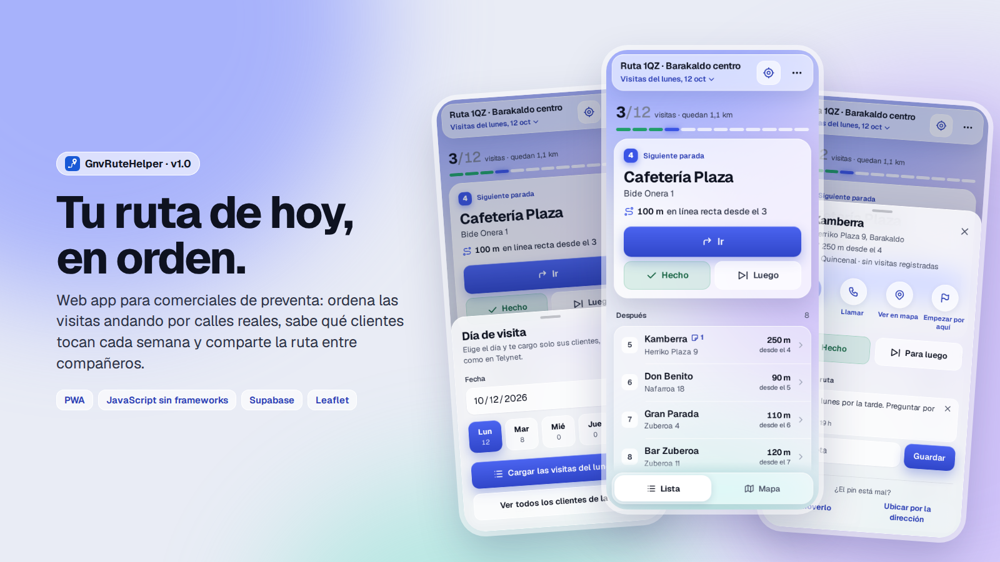
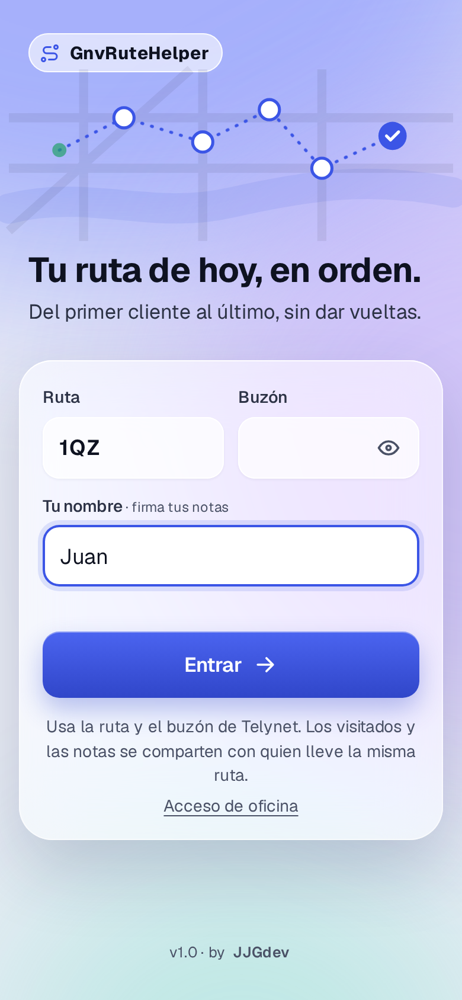
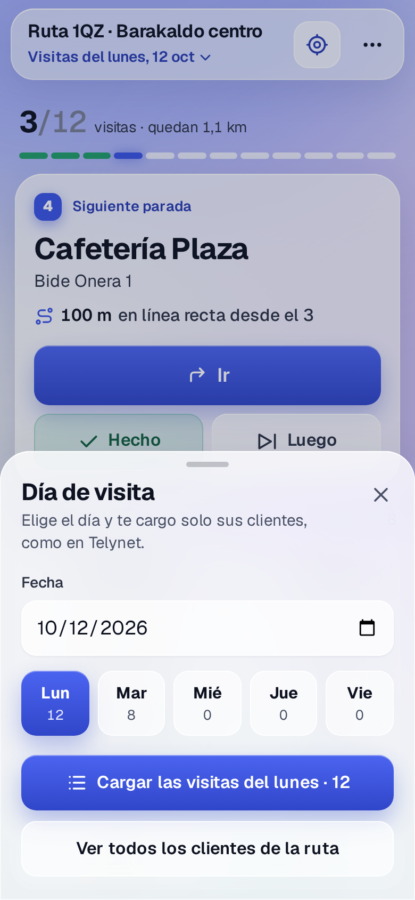
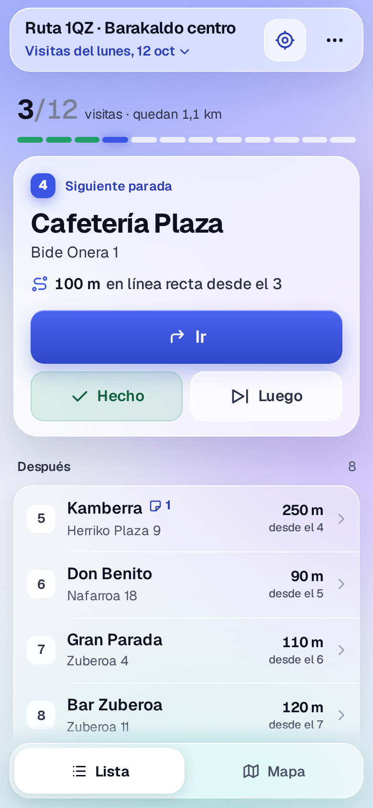
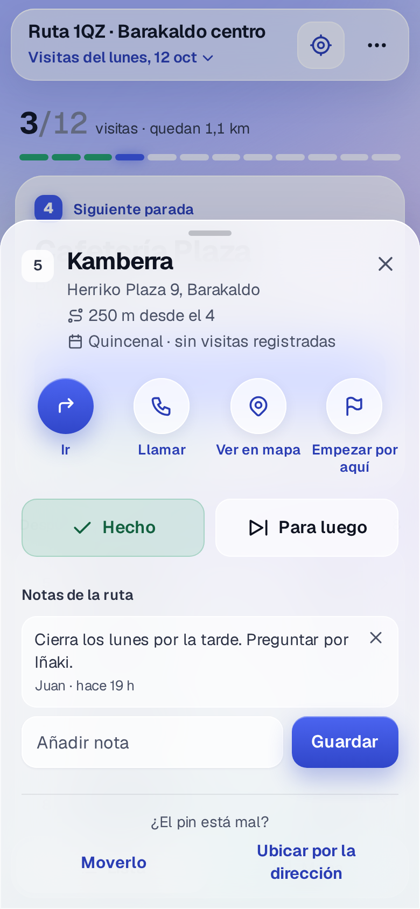
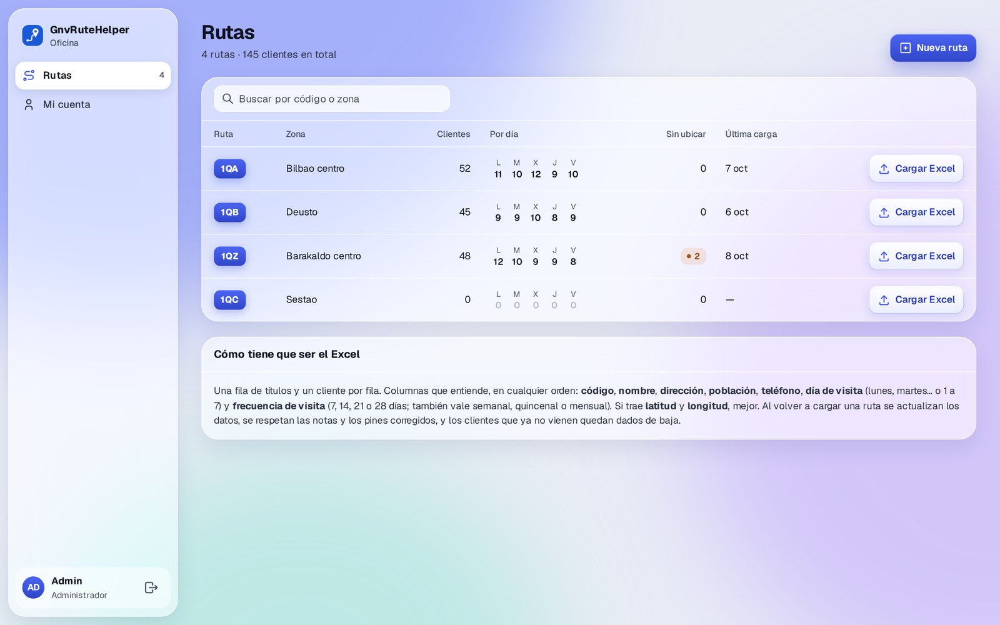
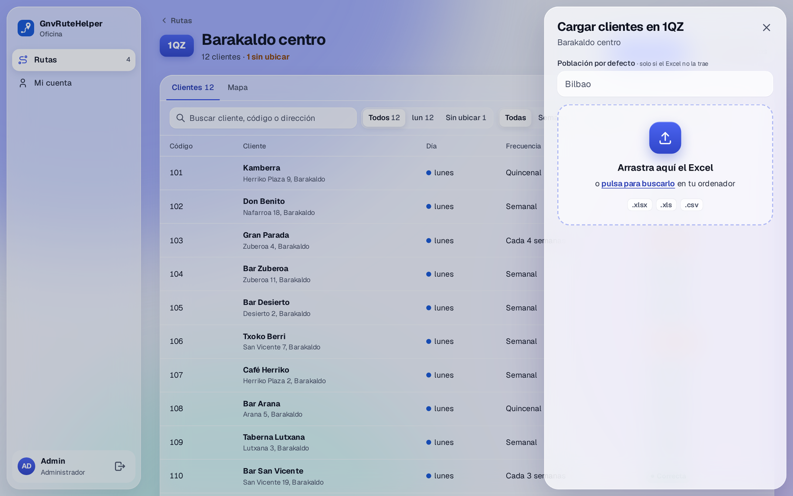
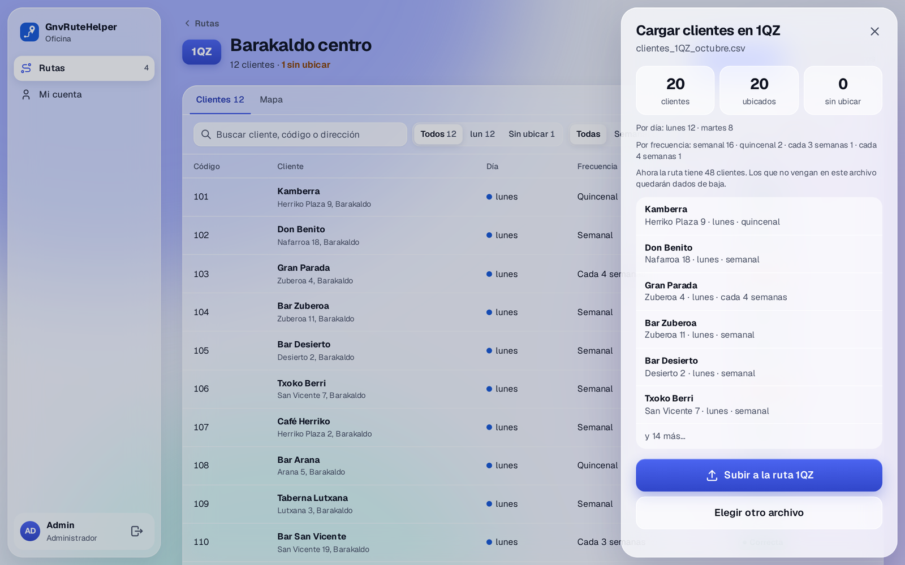
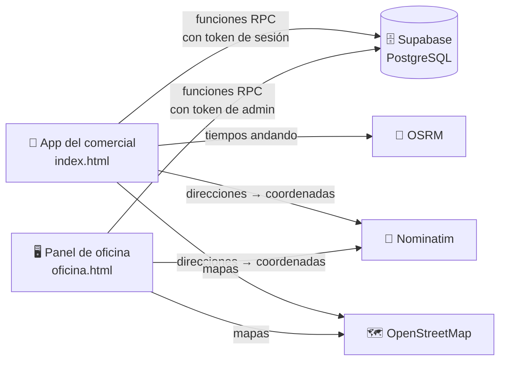

<div align="center">



# GnvRuteHelper

### Las visitas del día, ordenadas andando por calles reales

[](#-recorrido)
[](https://jjgdev.github.io/gnvrutehelper/)
[](#-la-app-del-comercial)


</div>

---

## 💡 El problema

Trabajo como comercial de preventa en una distribuidora de bebidas de Bilbao, cubriendo la ruta que haga falta el día que haga falta. El software de pedidos que usamos en las tablets da la lista de clientes del día **sin ningún orden**. Si conoces la zona, te apañas. Si cubres una ruta que no es la tuya, acabas guiándote con Google Maps, dando vueltas y, a veces, dejándote un bar que estaba a la vuelta de la esquina.

**GnvRuteHelper** nace de ahí: una web app que cualquier compañero abre en el móvil o la tablet, sin instalar nada, y que le dice **por dónde empezar y en qué orden seguir**.

## ✨ Qué hace

### 📱 La app del comercial

<table>
<tr>
<td width="25%"></td>
<td width="25%"></td>
<td width="25%"></td>
<td width="25%"></td>
</tr>
<tr>
<td align="center"><sub>Entrada con ruta y buzón</sub></td>
<td align="center"><sub>Día de visita</sub></td>
<td align="center"><sub>La ruta, en orden</sub></td>
<td align="center"><sub>Ficha del cliente</sub></td>
</tr>
</table>

- **Entrada con ruta + buzón**, igual que en el software de la empresa. Nada de cuentas nuevas.
- **Elige el día** y carga solo los clientes de ese día.
- **Orden de visita andando por calle**, no en línea recta, desde tu ubicación GPS o desde el cliente que elijas.
- **Frecuencias de visita** de 7, 14, 21 o 28 días: un cliente quincenal desaparece de la lista hasta que le vuelve a tocar, como en Telynet.
- **Ir · Hecho · Luego · Deshacer**: "Ir" abre la navegación en Google Maps y, al marcar "Hecho", el cliente baja animado a la sección de hechos.
- **Notas compartidas** por cliente ("cierra los lunes", "preguntar por Iñaki") y pines que se pueden corregir en el mapa.
- **Ruta compartida**: si dos personas llevan la misma ruta, ven al momento lo que ha visitado la otra (se sincroniza cada poco y al volver a la app).
- **Pensada para la calle**: funciona con poca cobertura (los cambios esperan en cola), gasta muy pocos datos móviles y se instala como una app, con icono y a pantalla completa.

### 🖥️ El panel de oficina



<table>
<tr>
<td width="50%"></td>
<td width="50%"></td>
</tr>
<tr>
<td align="center"><sub>Arrastrar el Excel de la ruta</sub></td>
<td align="center"><sub>Resumen antes de subirlo</sub></td>
</tr>
</table>

- **Un único administrador** que crea rutas, cambia buzones y las borra.
- **Carga de Excel o CSV** arrastrando el archivo. Reconoce las columnas aunque vengan en otro orden, ubica las direcciones en el mapa y enseña un resumen (clientes, días, frecuencias) antes de subir nada.
- **Edición de clientes**: día de visita, frecuencia y ubicación del pin.
- Al volver a cargar una ruta **se respetan las notas y los pines corregidos**, y los clientes que ya no vienen quedan de baja, no borrados.

> **Sin seguimiento a los comerciales, a propósito.** El panel no muestra visitas del día, horas, ubicación ni dispositivos conectados. Es una herramienta para organizar rutas, no para vigilar a quien las hace. Fue una decisión consciente de diseño.

## 🧠 Cómo funciona por dentro



**Ordenar la ruta.** Primero pido a OSRM una *matriz* con los minutos andando entre todos los clientes del día, en una sola llamada. Con esa matriz construyo una ruta con el algoritmo del **vecino más cercano** y luego la mejoro con **2-opt**, que deshace los cruces de la ruta intercambiando tramos. Todo se calcula en el propio móvil, así que reordenar no gasta datos.

**Seguridad sin cuentas.** Las tablas de Supabase están cerradas con RLS: desde fuera nadie puede leerlas ni escribirlas. La app solo puede llamar a unas pocas funciones de PostgreSQL que primero comprueban el token de sesión. El buzón se guarda cifrado con bcrypt, y tras 5 intentos fallidos la ruta se bloquea 15 minutos. Con la sesión de una ruta no se puede tocar ningún cliente de otra.

**Frecuencias.** Cada cliente tiene su frecuencia (7, 14, 21 o 28 días). La app conoce la fecha de su última visita marcada como "Hecho" y solo lo muestra cuando han pasado esos días, con 3 días de margen por si un día visitas la zona en otro día de la semana. Si no llegas a ir, te vuelve a salir la semana siguiente.

**Sin cobertura.** Cada acción se guarda primero en el dispositivo y entra en una cola que se envía al servidor cuando vuelve la señal. Para refrescar, la app no descarga la ruta entera: pide solo lo que ha cambiado desde la última vez. Bytes, no megas.

**Diseño.** Estilo *glassmorphism*: paneles de cristal esmerilado sobre un fondo de luces. Las luces están quietas dentro de la app para no gastar batería, y si el navegador no sabe desenfocar, los paneles pasan a ser casi opacos. Las animaciones (hojas que siguen el dedo, la lista que se reordena con la técnica FLIP, el indicador de pestañas) respetan el ajuste de "reducir movimiento" del móvil.

## 🗂️ El repositorio

```
├── index.html            ← la app del comercial (HTML + CSS + JS, sin frameworks)
├── oficina.html          ← el panel de oficina
├── sw.js                 ← service worker: abre al instante y funciona sin cobertura
├── manifest.webmanifest  ← datos para instalarla como app
├── icons/                ← iconos de la app
├── fonts/                ← tipografía Geist (licencia OFL), servida desde aquí
├── supabase/             ← los scripts SQL de la base de datos, en orden
└── docs/                 ← capturas de este README
```

<details>
<summary><b>Montar tu propia copia</b></summary>

1. Crea un proyecto gratuito en [Supabase](https://supabase.com).
2. En **SQL Editor**, ejecuta en orden los scripts de la carpeta `supabase/`.
3. Crea el usuario administrador del panel con la línea comentada al final del script del panel, poniendo tu propia contraseña.
4. Cambia `SUPABASE_URL` y `SUPABASE_KEY` (la clave pública `anon`) al principio del `<script>` de `index.html` y `oficina.html`.
5. Publica la carpeta en GitHub Pages, Netlify o cualquier hosting estático.
6. Entra en `oficina.html`, crea una ruta con su buzón y carga su Excel.

</details>

## 🗺️ Recorrido

- [x] **v0.1** — Prototipo con bares de prueba del centro de Barakaldo: ordenar la ruta desde el GPS *(oct 2026)*
- [x] **v0.2** — Base de datos común en Supabase: entrada con ruta + buzón, visitas y notas compartidas, cola sin cobertura *(oct 2026)*
- [x] **v0.3** — Orden por tiempo andando por calles reales (OSRM + 2-opt) y elegir el día de visita *(oct 2026)*
- [x] **v0.4** — App instalable (PWA) y paso de Netlify a GitHub Pages *(oct 2026)*
- [x] **v0.5** — Panel de oficina: la carga de Excel pasa a la oficina; luego se simplifica a un solo admin y sin seguimiento *(oct 2026)*
- [x] **v0.6** — Frecuencias de visita de 7, 14, 21 y 28 días *(oct 2026)*
- [x] **v1.0** — Rediseño completo en estilo cristal: animaciones, responsive y versión de escritorio *(oct 2026)*
- [ ] **Siguiente** — Pruebas con Excel reales de la empresa
- [ ] **Pendiente** — Mejorar la precisión del GPS en las tablets

## 📚 Lo que he aprendido

Este es mi primer proyecto que resuelve un problema real de mi trabajo. Lo he construido colaborando con IA, como cuento en [mi perfil](https://github.com/JJGdev): ella escribe código que todavía no sabría escribir solo, y yo lo destripo hasta entenderlo. Por el camino he aprendido, entre otras cosas:

- A **modelar una base de datos** de verdad: tablas, relaciones y por qué cerrarlas y exponer solo funciones.
- Que la **seguridad** se piensa desde el principio: contraseñas cifradas, bloqueo por intentos y aislar los datos de cada ruta.
- A trabajar con **APIs externas** con límites de uso (Nominatim, OSRM) y a guardar en caché para no repetir llamadas.
- Qué es una **PWA** y un *service worker*, y cómo hacer que una web funcione sin cobertura.
- Un poco de **algoritmia**: el problema del viajante, el vecino más cercano y 2-opt.
- **Diseño de interfaces** para gente que no se lleva bien con la tecnología: botones grandes, sin zoom accidental y sin pasos de más.
- Y que las mejores decisiones a veces son **quitar funciones**, como el seguimiento en el panel.

## 🙏 Créditos

- Mapas © colaboradores de [OpenStreetMap](https://www.openstreetmap.org/copyright).
- Direcciones con [Nominatim](https://nominatim.org) y tiempos andando con [OSRM](https://project-osrm.org).
- Mapa interactivo con [Leaflet](https://leafletjs.com) y lectura de Excel con [SheetJS](https://sheetjs.com).
- Tipografía [Geist](https://vercel.com/font) de Vercel, bajo licencia SIL Open Font License.
- Iconos de trazo inspirados en [Tabler Icons](https://tabler.io/icons).

---

<div align="center">

**v1.0 · by [JJGdev](https://github.com/JJGdev)** — Hecho con curiosidad, entre ruta y ruta

</div>
